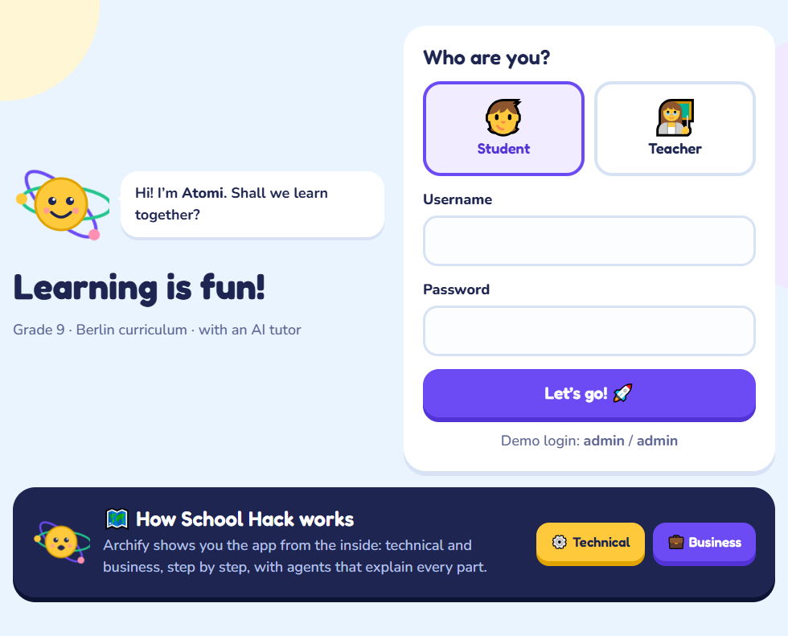
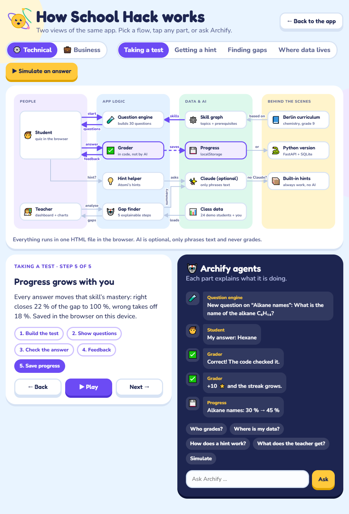
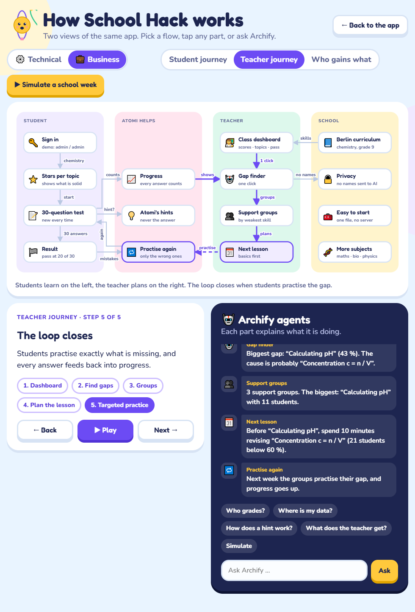
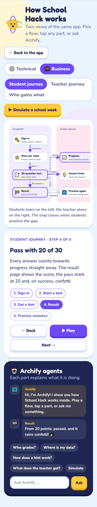
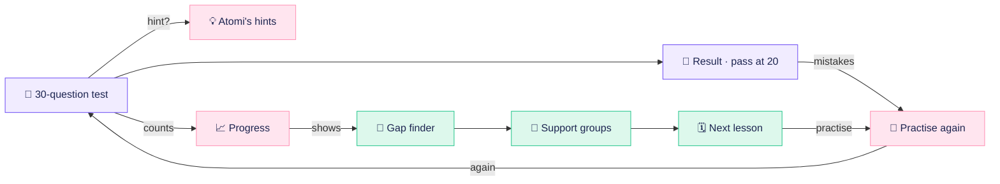
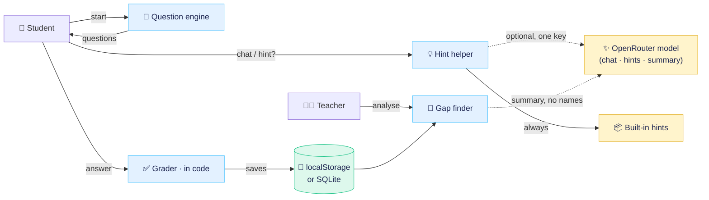

<div align="center">

# ⚗️ School Hack

**Kid-friendly grade 9 chemistry practice for the Berlin curriculum, in German and English.**
Adaptive tests, a friendly tutor called Atomi, a teacher dashboard with an explainable gap finder, and **Archify**, a live view of how it all fits together.


[🚀 Quick start](#-quick-start) · [🎒 Local demo](#-run-the-full-demo-locally) · [🗺️ Archify](#%EF%B8%8F-archify-how-it-fits-together) · [💼 Business flow](docs/business-flow.md) · [⚙️ Technical flow](docs/technical-flow.md) · [🛠️ Change things](#%EF%B8%8F-where-to-change-things)

</div>



## 🚀 Quick start

<details open>
<summary><b>Website</b>: no install, one file</summary>
<br>

1. Open `website/index.html` in a browser (double-click), or right-click it in VS Code → **Open with Live Server**.
2. Sign in as **Student** or **Teacher** with `admin` / `admin`.
3. Click **🗺️ How it works** in the footer, or open `website/index.html#archify`.

Progress is saved in the browser (`localStorage`), per device. Fonts and Chart.js load from a CDN, so the first load needs internet.
</details>

<details>
<summary><b>Python version</b>: FastAPI, SQLite, student and teacher portals</summary>
<br>

Requires Python 3.10 or newer.

```bash
cd backend-python
cp .env.example .env   # add OPENROUTER_API_KEY=sk-or-... for the chat
run.bat        # Windows (or ./run.sh on macOS / Linux)
```

Open <http://localhost:8000> and sign in with `admin` / `admin`. The SQLite database is created in `backend-python/data/` on first start. **The chat needs one key**: with `OPENROUTER_API_KEY` the KI-Tutor, the hints and the teacher summary all go straight to the OpenRouter model — no second server, no second key. The RAG service on :8080 is optional and only serves the textbook extras (figures, quiz/flashcard generators). See [backend-python/README.md](backend-python/README.md) for details and the team test checklist.
</details>

## 🐳 Docker (recommended for teammates)

If `setup.sh` / the Windows venv steps are painful, run the app with Docker
Desktop — no Python, virtualenv or model download on the host.

```bash
# The KI-Tutor currently lives on anil-dev, NOT on main:
git clone --depth 1 --branch anil-dev https://github.com/RezaurRahman47/SchoolHack.git
cd SchoolHack
cp .env.example .env      # set OPENROUTER_API_KEY=sk-or-...
docker compose up --build app     # app :8000 only — chat works
```

Open <http://localhost:8000> → `admin` / `admin` → **KI-Tutor**.

Want the textbook sources, pages and figures as well? Add the RAG service
(app **:8000** + RAG **:8080**):

```bash
docker compose up --build
```

The RAG image downloads ~3.8 GB of models **once** into a Docker volume; later
starts take seconds. `docker compose down` keeps models and the SQLite database,
`docker compose down -v` deletes both. You can also start the RAG service later
with `docker compose up -d rag` — the app picks it up on its own.

Don't open `backend-python/app/templates/tutor.html` directly — it is a Jinja
template and only works through the running app.

Full guide, port overrides, offline model transfer and troubleshooting:
**[docs/DOCKER.md](docs/DOCKER.md)**.

## 🎒 Full demo on a fresh laptop (teammates / hackathon)

> [!IMPORTANT]
> The current student portal, AI tutor and RAG overhaul lives on the
> **`anil-dev`** branch. A plain `git clone` checks out `main`, which does **not**
> contain `tutor.html`. Add `--branch anil-dev` until `anil-dev` is merged into
> `main`.

The textbook RAG index is committed, so a clone works **without the PDF**:

```bash
git clone --branch anil-dev https://github.com/RezaurRahman47/SchoolHack.git
cd SchoolHack
./setup.sh                 # Python >= 3.10; creates both venvs
# add your own key to vectorstore/.env or backend-python/.env
./run_demo.sh              # RAG :8080 + SchoolHack :8000
```

Open <http://localhost:8000> → `admin` / `admin`. SQLite is seeded automatically.

Only want the chat, without the RAG service and its 3.8 GB of models? Start just
the app:

```bash
./run_demo.sh app          # app :8000 only; chat answers from the in-app model
```

**Windows:** `setup.sh` and `run_demo.sh` are macOS/Linux only. Use the native
PowerShell commands in [docs/SETUP_WINDOWS.md](docs/SETUP_WINDOWS.md), or run
the same scripts inside WSL.

- First `setup.sh` downloads the two local models (~3.8 GB, one time). For the
  demo, copy `~/.cache/huggingface/hub/models--google--embeddinggemma-2` and
  `models--BAAI--bge-reranker-v2-m3` via USB and run `SKIP_MODELS=1 ./setup.sh`.
- `vectorstore/.env` is **not** committed. Each person uses their own
  `OPENROUTER_API_KEY`.
- If your Mac stays home, see [scripts/remote_demo.md](scripts/remote_demo.md)
  for Tailscale + SSH (`localhost` on the venue laptop) or Cloudflare Tunnel.

## ✨ What it does

| | For students 🧒 | For teachers 👩‍🏫 |
|---|---|---|
| **Practice** | 30 fresh questions each time across 25 skills, pass at **20 / 30** | Pass rate, average points and students below 20 at a glance |
| **Help** | Atomi's hints: a nudge first, the method second, never just the answer | 🤖 Gap finder: weak skills, likely causes, support groups, next steps |
| **Feedback** | Instant ⭐, streaks, and an explanation for typical mistakes | "Where are they stuck?" chart, hardest topics first |
| **Learning** | Only wrong questions come back, round after round | Filter by class (9a / 9b) |

> [!IMPORTANT]
> **Code grades, AI never does.** Every answer is checked in code. The model (OpenRouter) is optional and only phrases the chat, the hints and the teacher summary. It never sees student names.

## 🗺️ Archify: how it fits together

**Archify** is a view inside the app that explains School Hack from the inside, as two live diagrams of the same app. Open it from the login page, from the footer, or with `website/index.html#archify`.

- **⚙️ Technical / 💼 Business:** switch the lens. Boxes pop in and arrows draw themselves.
- **Flows:** pick one (*Taking a test*, *Getting a hint*, *Finding gaps*, *Where data lives*, *Student journey*, *Teacher journey*, *Who gains what*), then step through it or press **▶ Play**. A dot travels along the arrow that is working.
- **Hover or tap a box** to light up its connections and read what it does.
- **🤖 Archify agents:** each part narrates its own step in the chat.
- **Ask Archify:** tap a suggested question or type one ("Who grades?", "Where is my data?", "Wo sind meine Daten?"). Archify switches to the matching flow and answers. Questions are matched in the browser and never leave it.
- **▶ Simulate:**
  - *Technical:* a real question from the question engine goes through the real grader and shows the mastery change. Nothing is saved.
  - *Business:* a school week on the demo class, using the real gap finder.

| ⚙️ Technical: simulate an answer | 💼 Business: simulate a school week |
|---|---|
|  |  |

<details>
<summary>📱 On phones</summary>
<br>

The diagram scrolls sideways and follows the part that is working; everything else stacks.


</details>

### Business flow in one picture



**[→ Full business flow](docs/business-flow.md)**: student journey, teacher journey, who gains what.

### Technical flow in one picture



**[→ Full technical flow](docs/technical-flow.md)**: sequences for tests, hints and the gap finder, the Python routes, and where data lives.

## 🤖 Archify agent for Claude Code

When a feature, flow or skill changes, run the **`archify`** agent ([`.claude/agents/archify.md`](.claude/agents/archify.md)) in Claude Code:

> *"Use the archify agent: we added a Maths subject with 6 skills."*

It updates the two flow docs, the README diagrams and the in-app Archify view together, checks every claim against the code, verifies the page in a browser and regenerates the screenshots.

## 🛠️ Where to change things

<details>
<summary>Everything lives in <code>website/index.html</code>: search for these names</summary>
<br>

| What | Search for |
|---|---|
| Colours, fonts, sizes | `:root {` at the top of `<style>` |
| All German / English UI text | `const UI = {` |
| Topics and skills (with prerequisites) | `const SKILLS = {` |
| Question templates, answers, mistake hints | `const T = {` |
| Built-in hints | `const TIPS = {` |
| Pass mark (20) and test length (30) | `const PASS = 20` |
| Login check (`admin` / `admin`) | `viewLogin` |
| Teacher demo class | `function demoClass` |
| Gap finder logic | `function analyse` |
| Archify diagrams, flows and agent lines | `const ARCH = {` |
| What Archify understands when asked | `AX_INTENTS` |
| Archify simulations | `async function axSim` |
</details>

<details>
<summary>Regenerate the screenshots</summary>
<br>

```bash
npm i --no-save playwright
npx playwright install chromium
node scripts/screenshots.js
```

The script opens Archify deep links such as `#archify/tech/test/2/en` and `#archify/biz/student/sim/en` and saves the crops to `docs/images/`.
</details>

## 📁 Project structure

```text
SchoolHack/
├── website/index.html          the standalone app (UI, questions, grading, gap finder, Archify)
├── backend-python/             FastAPI + SQLite version with student and teacher portals
│   └── app/                    main.py · questions.py · db.py · agent.py · llm.py · templates/ · static/
├── Dockerfile                  multi-target image: "app" (:8000) and "rag" (:8080)
├── docker-compose.yml          one command for the full Docker stack
├── docs/
│   ├── DOCKER.md               Docker setup, offline models, troubleshooting
│   ├── business-flow.md        student journey, teacher journey, who gains what
│   ├── technical-flow.md       architecture, sequences, where data lives
│   └── images/                 screenshots used in the README
├── scripts/screenshots.js      regenerates docs/images from website/index.html
└── .claude/agents/archify.md   the Archify Claude Code agent
```

> [!NOTE]
> Demo boundaries: both roles use `admin` / `admin`; the teacher dashboard shows 24 made-up students (marked as example data) plus your own last test; login is a demo, not a production user system.

## 🎒 Run the full demo locally

This starts the complete stack on **one laptop**: FastAPI + SQLite, the web UI and
— optionally — the local RAG service (ChromaDB + EmbeddingGemma 2 + reranker) for
textbook sources and figures. The textbook index is already committed, so **the
PDF is not needed**. No tunnel is needed when everything runs on the same
machine.

Chat alone needs only the app plus an `OPENROUTER_API_KEY` (see
`./run_demo.sh app` below); the RAG service is what needs the 3.8 GB of models.

### What runs where

| Component | Port | Location in the clone |
|---|---:|---|
| SchoolHack web app | **8000** | `backend-python/` |
| RAG API (optional: textbook sources) | **8080** | `vectorstore/server.py` |
| Vector store (ChromaDB) | — | `vectorstore/processed_data_v2/chroma/` |
| Textbook images | — | `vectorstore/processed_data_v2/images/` |
| SQLite database | — | `backend-python/data/chemtutor.db` (created on first start) |
| Local models (~3.8 GB, RAG only) | — | `~/.cache/huggingface/hub` (downloaded once) |

The vector store is **21 MB** and contains 243 text chunks + 162 indexed images
(729 vectors, collection `chemie_rag_v2`). The 3.8 GB model cache is separate
from Git and is downloaded on first setup.

### macOS / Linux

```bash
git clone --branch anil-dev https://github.com/RezaurRahman47/SchoolHack.git
cd SchoolHack
python3 --version          # must be 3.10 or newer
./setup.sh                 # one time: venvs, packages, .env, models
nano backend-python/.env   # add OPENROUTER_API_KEY=sk-or-... (chat needs it)
./run_demo.sh              # every time: RAG :8080 + app :8000
# or, without the RAG service and its models:
./run_demo.sh app          # app :8000 only; chat still works, no book sources
```

Open <http://localhost:8000> and sign in with `admin` / `admin`.
Press `Ctrl+C` to stop the server(s).

- If `./setup.sh` says “permission denied”:
  `chmod +x setup.sh run_demo.sh vectorstore/run.sh`.
- If the models were copied from another machine (USB), skip the download:
  `SKIP_MODELS=1 ./setup.sh`. Copy these two folders to the same path:
  `~/.cache/huggingface/hub/models--google--embeddinggemma-2` and
  `models--BAAI--bge-reranker-v2-m3`.
- `setup.sh` and `run_demo.sh` are **macOS/Linux bash scripts**. On Windows use
  the PowerShell steps below, or run the same scripts inside WSL.

### Windows (native PowerShell)

Prerequisites: Windows 10/11, **Python 3.12** from
<https://python.org> (tick “Add python.exe to PATH”), Git, and internet.
Open PowerShell in the folder where you want the repo.

**1. Clone**

```powershell
git clone https://github.com/RezaurRahman47/SchoolHack.git
cd SchoolHack
```

**2. RAG environment**

```powershell
py -3.12 -m venv vectorstore\.venv-v2
vectorstore\.venv-v2\Scripts\python.exe -m pip install --upgrade pip
vectorstore\.venv-v2\Scripts\python.exe -m pip install -r vectorstore\requirements-v2.txt
```

**3. SchoolHack environment**

```powershell
py -3.12 -m venv backend-python\.venv
backend-python\.venv\Scripts\python.exe -m pip install --upgrade pip
backend-python\.venv\Scripts\python.exe -m pip install -r backend-python\requirements.txt
```

If `py -3.12` is not found, use `python` instead (it must be >= 3.10).

**4. Environment files**

```powershell
Copy-Item vectorstore\.env.example vectorstore\.env
notepad vectorstore\.env
```

Put your key in the file:

```env
OPENROUTER_API_KEY=sk-or-...
```

The default `RAG_BASE=http://localhost:8080/api` is correct for a local demo.
`backend-python\.env` should carry your `OPENROUTER_API_KEY` — the only key the app
uses (the same key also works from `vectorstore\.env`).

**5. Models for the RAG service (optional, one time, ~3.8 GB)**

Only needed for textbook sources and figures. Chat works without it.

```powershell
vectorstore\.venv-v2\Scripts\python.exe scripts\download_models.py
```

To skip this at the venue, copy the two Hugging Face folders from the Mac to
`%USERPROFILE%\.cache\huggingface\hub\`.

**6. Start RAG (optional) — PowerShell window 1**

Open a PowerShell window in the `SchoolHack` folder:

```powershell
cd vectorstore
$env:RAG_RERANK_CANDIDATES="8"
$env:RAG_IMAGE_RERANK="4"
$env:RAG_IMAGE_VLM_CHECK="0"
.venv-v2\Scripts\python.exe server.py
```

Health check: <http://localhost:8080/api/status>

**7. Start SchoolHack — PowerShell window 2 (or window 1, if you skipped step 6)**

Open a second PowerShell window in the `SchoolHack` folder:

```powershell
cd backend-python
.venv\Scripts\python.exe -m uvicorn app.main:app --host 0.0.0.0 --port 8000
```

Open <http://localhost:8000> → `admin` / `admin`.
SQLite is created and seeded in `backend-python\data\` on first start.

**8. Warm the demo cache (optional, recommended) — window 3**

```powershell
Invoke-RestMethod -Method Post -Uri http://localhost:8080/api/warmup `
  -ContentType "application/json" `
  -Body '{"questions":["Was ist der pH-Wert?","Warum leitet eine Salzlösung Strom?","Was passiert bei einer Neutralisation?","Was sind Alkane?"]}'
```

Troubleshooting: see [docs/SETUP_WINDOWS.md](docs/SETUP_WINDOWS.md).

### Windows via WSL (closest to macOS)

If WSL is allowed on the laptop, the macOS/Linux scripts work unchanged:

```powershell
wsl --install -d Ubuntu
```

Inside Ubuntu:

```bash
sudo apt update && sudo apt install -y git python3.12 python3.12-venv
git clone https://github.com/RezaurRahman47/SchoolHack.git
cd SchoolHack
./setup.sh
./run_demo.sh
```

Open <http://localhost:8000> in the Windows browser; WSL2 forwards localhost.

### Expected speed

| Laptop | New question | Cached question |
|---|---:|---:|
| Apple Silicon Mac (M1–M4) | **~3–4 s** | **0.001 s** |
| Intel Mac / mid-range CPU | ~6–10 s | 0.001 s |
| Windows / CPU-only | ~6–12 s | 0.001 s |
| Windows with the `RAG_*` fast flags | ~4–8 s | 0.001 s |

The vector store itself is fast (ChromaDB query + BM25 < 50 ms). The local
embedding + reranker models are the variable part; the answer model and the
final image check call OpenRouter, so **internet is required** for generated
answers. Without a valid key the app still runs; the AI tutor then shows a short
"tutor unavailable" message instead of inventing an answer.

### Demo checklist

- [ ] `git clone` on the presentation laptop
- [ ] Python >= 3.10 available
- [ ] `setup.sh` / Windows venv steps completed
- [ ] `backend-python/.env` (or `vectorstore/.env`) has a working `OPENROUTER_API_KEY`
- [ ] `./run_demo.sh app` starts the chat — **no RAG server needed**
- [ ] for textbook sources: models downloaded, or the two Hugging Face cache folders copied via USB
- [ ] ports 8000 (and 8080, for the RAG server) free
- [ ] `run_demo.sh` / the PowerShell windows running
- [ ] <http://localhost:8000> opens; `admin` / `admin` works
- [ ] one KI-Tutor question answered (chat needs no RAG server)

### If the Mac stays at home

Every command above runs on the presentation laptop, so the Mac is not needed
and there is **no tunnel**. If you instead want the Mac to host the stack, see
[scripts/remote_demo.md](scripts/remote_demo.md):

- **Tailscale + SSH port forwarding** — gives you a real `localhost:8000` and
  `localhost:8080` on the venue laptop; the tunnel runs **on the Mac**.
- **Cloudflare Tunnel** — browser-only access to the app on port 8000; again the
  tunnel runs on the Mac, and port 8080 must not be exposed.
