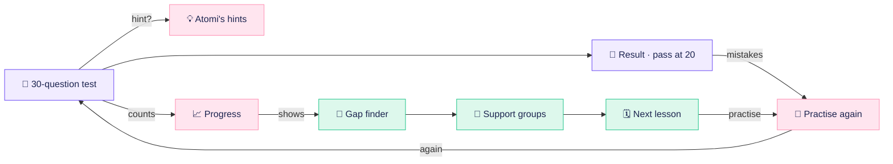
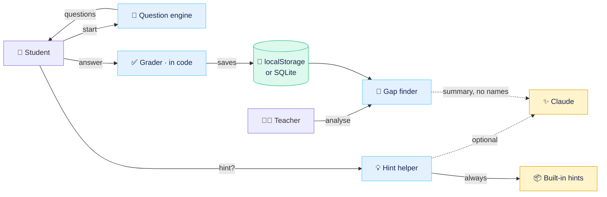

<div align="center">

# ⚗️ School Hack

**Kid-friendly grade 9 chemistry practice for the Berlin curriculum, in German and English.**
Adaptive tests, a friendly tutor called Atomi, a teacher dashboard with an explainable gap finder, and **Archify**, a live view of how it all fits together.


[🚀 Quick start](#-quick-start) · [🗺️ Archify](#%EF%B8%8F-archify-how-it-fits-together) · [💼 Business flow](docs/business-flow.md) · [⚙️ Technical flow](docs/technical-flow.md) · [🛠️ Change things](#%EF%B8%8F-where-to-change-things)

</div>


## 🚀 Quick start

<details open>
<summary><b>Website</b>: no install, one file</summary>
<br>

1. Open `website/index.html` in a browser (double-click), or right-click it in VS Code → **Open with Live Server**.
2. Sign in as **Student** or **Teacher** with `admin` / `admin`.
3. Click **🗺️ How it works** in the footer, or open `website/index.html#archify`.

Progress is saved in the browser (`localStorage`), per device. Fonts and Chart.js load from a CDN, so the first load needs internet.
</details>

<details>
<summary><b>Python version</b>: FastAPI, SQLite, student and teacher portals</summary>
<br>

Requires Python 3.10 or newer.

```bash
cd backend-python
run.bat        # Windows (or ./run.sh on macOS / Linux)
```

Open <http://localhost:8000> and sign in with `admin` / `admin`. The SQLite database is created in `backend-python/data/` on first start. For Claude-written hints and teacher summaries, copy `.env.example` to `.env` and set `ANTHROPIC_API_KEY`; without it, the built-in hints and summaries are used. See [backend-python/README.md](backend-python/README.md) for details and the team test checklist.
</details>

## 🎒 Full demo on a fresh laptop (teammates / hackathon)

The textbook RAG index is committed, so a clone works **without the PDF**:

```bash
git clone https://github.com/RezaurRahman47/SchoolHack.git
cd SchoolHack
./setup.sh                 # Python >= 3.10; creates both venvs
# add your own key to vectorstore/.env
./run_demo.sh              # RAG :8080 + SchoolHack :8000
```

Open <http://localhost:8000> → `admin` / `admin`. SQLite is seeded automatically.

**Windows:** `setup.sh` and `run_demo.sh` are macOS/Linux only. Use the native
PowerShell commands in [docs/SETUP_WINDOWS.md](docs/SETUP_WINDOWS.md), or run
the same scripts inside WSL.

- First `setup.sh` downloads the two local models (~3.8 GB, one time). For the
  demo, copy `~/.cache/huggingface/hub/models--google--embeddinggemma-2` and
  `models--BAAI--bge-reranker-v2-m3` via USB and run `SKIP_MODELS=1 ./setup.sh`.
- `vectorstore/.env` is **not** committed. Each person uses their own
  `OPENROUTER_API_KEY`.
- If your Mac stays home, see [scripts/remote_demo.md](scripts/remote_demo.md)
  for Tailscale + SSH (`localhost` on the venue laptop) or Cloudflare Tunnel.

## ✨ What it does

| | For students 🧒 | For teachers 👩‍🏫 |
|---|---|---|
| **Practice** | 30 fresh questions each time across 15 skills, pass at **20 / 30** | Pass rate, average points and students below 20 at a glance |
| **Help** | Atomi's hints: a nudge first, the method second, never just the answer | 🤖 Gap finder: weak skills, likely causes, support groups, next steps |
| **Feedback** | Instant ⭐, streaks, and an explanation for typical mistakes | "Where are they stuck?" chart, hardest topics first |
| **Learning** | Only wrong questions come back, round after round | Filter by class (9a / 9b) |

> [!IMPORTANT]
> **Code grades, AI never does.** Every answer is checked in code. Claude is optional and only phrases hints and the teacher summary. It never sees student names.

## 🗺️ Archify: how it fits together

**Archify** is a view inside the app that explains School Hack from the inside, as two live diagrams of the same app. Open it from the login page, from the footer, or with `website/index.html#archify`.

- **⚙️ Technical / 💼 Business:** switch the lens. Boxes pop in and arrows draw themselves.
- **Flows:** pick one (*Taking a test*, *Getting a hint*, *Finding gaps*, *Where data lives*, *Student journey*, *Teacher journey*, *Who gains what*), then step through it or press **▶ Play**. A dot travels along the arrow that is working.
- **Hover or tap a box** to light up its connections and read what it does.
- **🤖 Archify agents:** each part narrates its own step in the chat.
- **Ask Archify:** tap a suggested question or type one ("Who grades?", "Where is my data?", "Wo sind meine Daten?"). Archify switches to the matching flow and answers. Questions are matched in the browser and never leave it.
- **▶ Simulate:**
  - *Technical:* a real question from the question engine goes through the real grader and shows the mastery change. Nothing is saved.
  - *Business:* a school week on the demo class, using the real gap finder.

| ⚙️ Technical: simulate an answer | 💼 Business: simulate a school week |
|---|---|
|  |  |

<details>
<summary>📱 On phones</summary>
<br>

The diagram scrolls sideways and follows the part that is working; everything else stacks.


</details>

### Business flow in one picture



**[→ Full business flow](docs/business-flow.md)**: student journey, teacher journey, who gains what.

### Technical flow in one picture



**[→ Full technical flow](docs/technical-flow.md)**: sequences for tests, hints and the gap finder, the Python routes, and where data lives.

## 🤖 Archify agent for Claude Code

When a feature, flow or skill changes, run the **`archify`** agent ([`.claude/agents/archify.md`](.claude/agents/archify.md)) in Claude Code:

> *"Use the archify agent: we added a Maths subject with 6 skills."*

It updates the two flow docs, the README diagrams and the in-app Archify view together, checks every claim against the code, verifies the page in a browser and regenerates the screenshots.

## 🛠️ Where to change things

<details>
<summary>Everything lives in <code>website/index.html</code>: search for these names</summary>
<br>

| What | Search for |
|---|---|
| Colours, fonts, sizes | `:root {` at the top of `<style>` |
| All German / English UI text | `const UI = {` |
| Topics and skills (with prerequisites) | `const SKILLS = {` |
| Question templates, answers, mistake hints | `const T = {` |
| Built-in hints | `const TIPS = {` |
| Pass mark (20) and test length (30) | `const PASS = 20` |
| Login check (`admin` / `admin`) | `viewLogin` |
| Teacher demo class | `function demoClass` |
| Gap finder logic | `function analyse` |
| Archify diagrams, flows and agent lines | `const ARCH = {` |
| What Archify understands when asked | `AX_INTENTS` |
| Archify simulations | `async function axSim` |
</details>

<details>
<summary>Regenerate the screenshots</summary>
<br>

```bash
npm i --no-save playwright
npx playwright install chromium
node scripts/screenshots.js
```

The script opens Archify deep links such as `#archify/tech/test/2/en` and `#archify/biz/student/sim/en` and saves the crops to `docs/images/`.
</details>

## 📁 Project structure

```text
SchoolHack/
├── website/index.html          the standalone app (UI, questions, grading, gap finder, Archify)
├── backend-python/             FastAPI + SQLite version with student and teacher portals
│   └── app/                    main.py · questions.py · db.py · agent.py · llm.py · templates/ · static/
├── docs/
│   ├── business-flow.md        student journey, teacher journey, who gains what
│   ├── technical-flow.md       architecture, sequences, where data lives
│   └── images/                 screenshots used in the README
├── scripts/screenshots.js      regenerates docs/images from website/index.html
└── .claude/agents/archify.md   the Archify Claude Code agent
```

> [!NOTE]
> Demo boundaries: both roles use `admin` / `admin`; the teacher dashboard shows 24 made-up students (marked as example data) plus your own last test; login is a demo, not a production user system.
