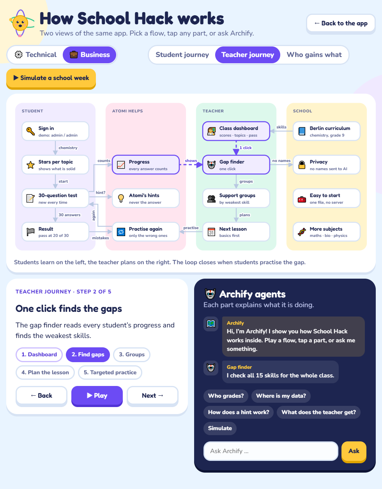
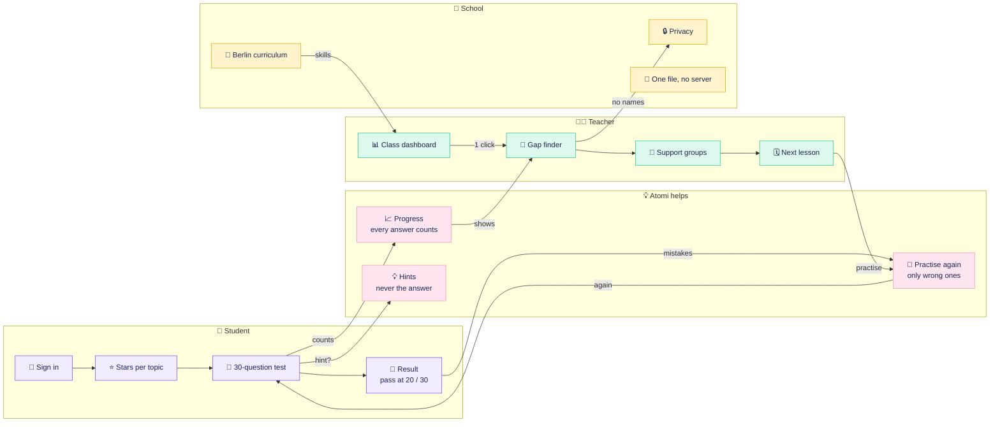
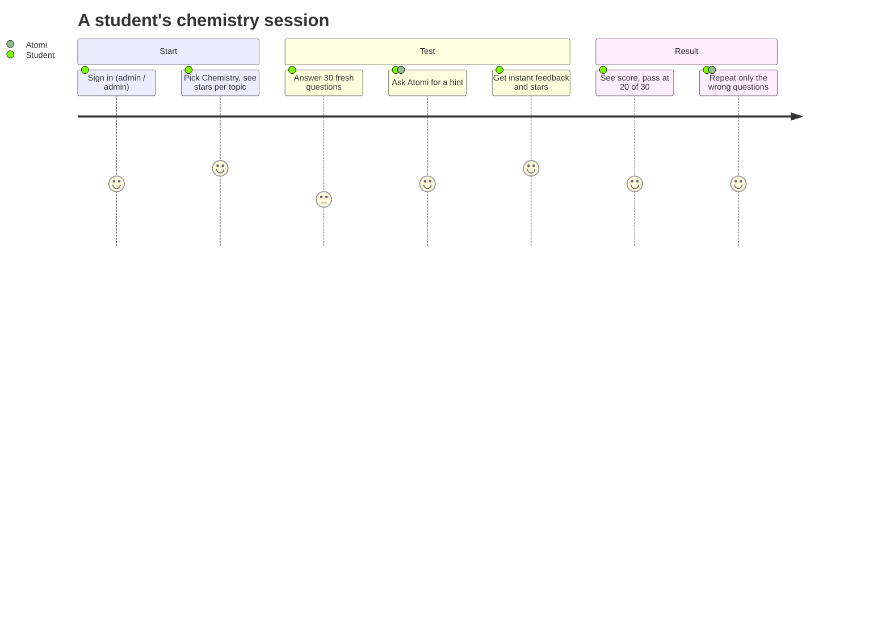
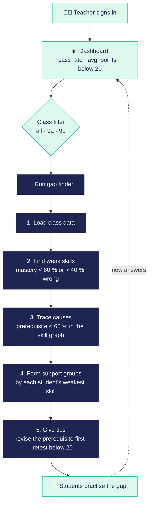

# 💼 Business flow

How School Hack creates value for students, teachers and the school. These diagrams match the **Business** lens of the in-app Archify view. Open [`website/index.html#archify/biz`](../website/index.html) and press **Play**, or **Simulate a school week**.

## The whole loop at a glance

<b>🧒 Student journey</b>: sign in → test → hints → result → practise mistakes

 

| Step | What happens | Where in the code |
|---|---|---|
| 1. Sign in | Pick *Student*, log in, open Chemistry. Stars per topic show what is already solid. | `viewLogin`, `viewChem` |
| 2. Fresh test | 30 new questions every start, two per skill, from templates with random values. | `buildTest`, `T` |
| 3. Hints | First hint is a nudge without the answer; the second shows the method. | `tip`, `TIPS` |
| 4. Result | Every answer updates mastery straight away. Pass with **20 of 30** in round 1, with confetti on success. | `answer`, `viewRoundResult` |
| 5. Practise mistakes | Only wrong questions come back, round after round, with the method from round 2. | `quiz.wrong` |

<b>👩‍🏫 Teacher journey</b>: dashboard → gap finder → groups → next lesson

 

The summary at the top of the result uses Claude only when it is available (on claude.ai, or with `ANTHROPIC_API_KEY` in the Python version). Otherwise the code writes it. Either way, Claude only receives skill names and percentages, never student names.

<b>🏫 Who gains what</b>

 

| Who | What they get |
|---|---|
| 🧒 **Students** | Practice without fear: hints instead of answers, stars and streaks, mistakes simply come back. |
| 👩‍🏫 **Teachers** | No marking 30 questions × 24 students. Gaps, likely causes, groups and next steps in one click. |
| 🏫 **School** | Content from the Berlin-Brandenburg curriculum (grade 9 chemistry), German and English. |
| 🔒 **Privacy** | The website stores data only in the browser. AI is optional, never grades and never sees names. |
| 🧰 **Getting started** | One HTML file, no build step, no server. New subjects are added as new skills and templates. |

## Demo boundaries

> [!NOTE]
> - Both roles use the demo login `admin / admin`. Login is a demo, not a production user system.
> - The teacher dashboard shows **24 made-up students** (marked as example data) plus your own last test.
> - School Hack has no pricing model yet. Nothing on this page is a business figure.
