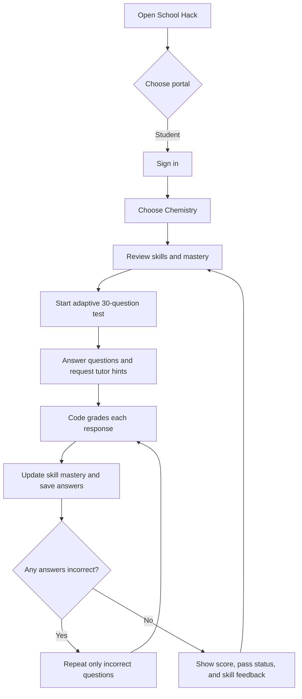
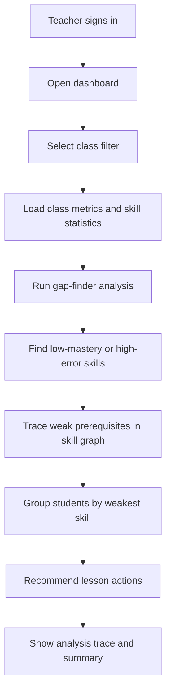

# Business Flow

## Student learning journey

1. Students sign in to the student portal and open Chemistry.
2. The app shows the skill graph, topics, prior tests, and current mastery.
3. A new test contains 30 questions, weighted toward skills with lower mastery.
4. The student can ask for a hint. Grading remains deterministic in application code; an optional Claude-backed tutor can phrase hints, with built-in hints as fallback.
5. Each submitted answer updates the student's mastery estimate and is persisted. Only incorrect questions appear in the next retry round.
6. The result page reports the first-round score and pass status (20/30), remaining incorrect answers, and skill-level feedback.

## Teacher analysis journey

The teacher dashboard presents class KPIs, score trends, pass/fail information, and skill mastery. The gap-finder agent analyzes these data in five stages: load class data, identify gaps, trace prerequisite causes, form support groups, and recommend teaching actions. The summary uses Claude only when an API key is configured; otherwise, a rule-based summary is returned. The teacher can filter the analysis by class (9a/9b).

## Demo boundaries

- Both portals use the demo credentials `admin / admin`.
- Student progress and class analytics use the local SQLite database.
- The teacher dashboard is seeded with fictional demo learners so its charts have sample data.
- Login is a demo implementation, not a production user-management system.
