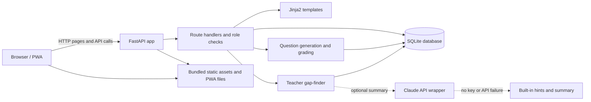
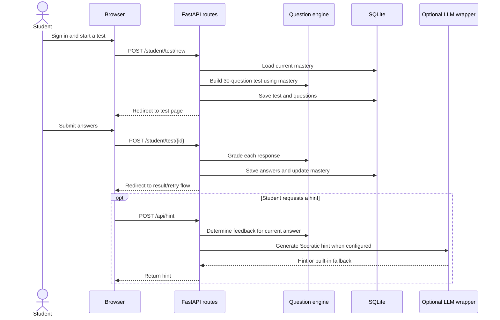
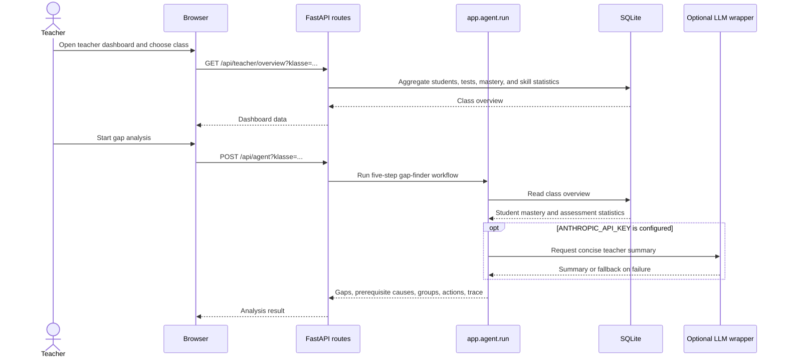

# Technical Flow

## Runtime architecture

## Student request and persistence sequence

## Teacher-analysis sequence

## Components and responsibilities

- `backend-python/app/main.py`: FastAPI app, page/API routes, role checks, and startup database initialization.
- `backend-python/app/questions.py`: skill graph, adaptive test assembly, answer grading, and feedback.
- `backend-python/app/db.py`: SQLite schema, demo seeding, persistence, mastery updates, and class analytics.
- `backend-python/app/agent.py`: explainable teacher gap-finder and suggested interventions.
- `backend-python/app/llm.py`: optional Claude integration with local fallback behavior.
- `backend-python/app/templates/` and `backend-python/app/static/`: server-rendered pages and bundled styles, charts, icons, and PWA assets.
- `website/index.html`: standalone browser-based version; no backend/build step required.

## Local request lifecycle

The Python version is served by Uvicorn on port 8000. FastAPI renders Jinja templates and serves the static/PWA assets. On startup, the app initializes SQLite and seeds demo records when the student table is empty. The optional Anthropic integration is disabled unless `ANTHROPIC_API_KEY` is provided; core grading and fallback explanations work without it.
