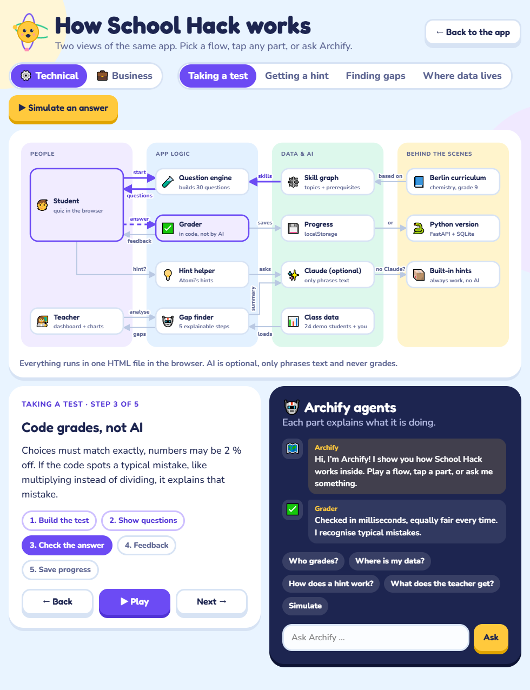
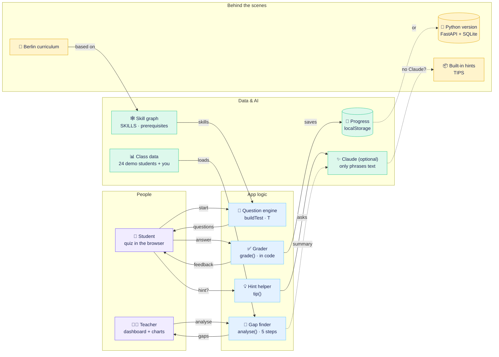
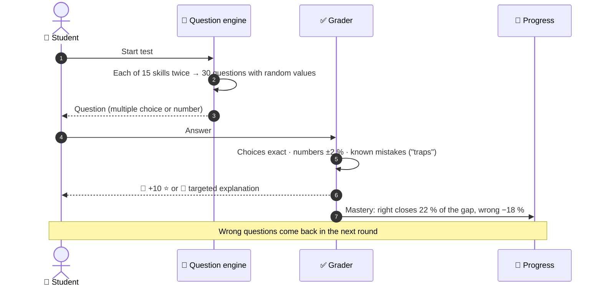
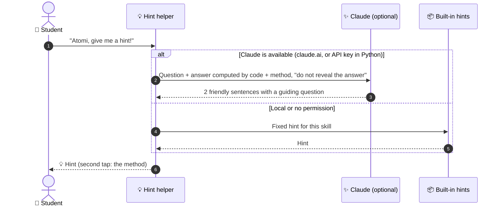
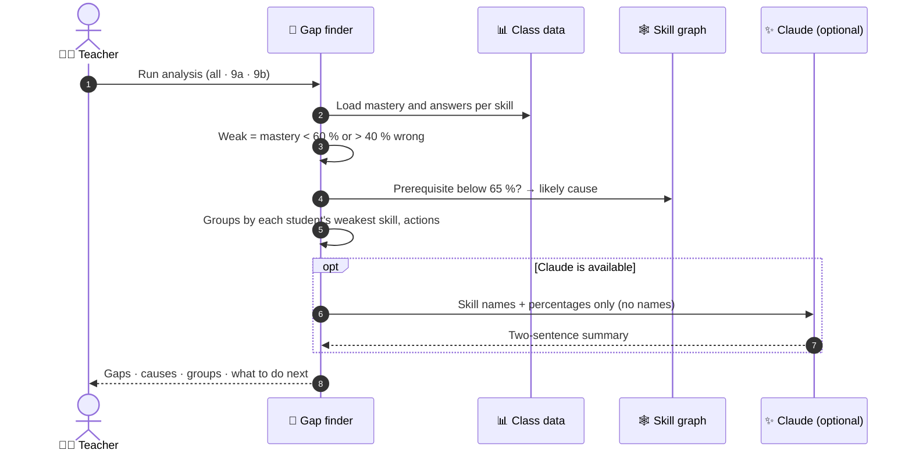
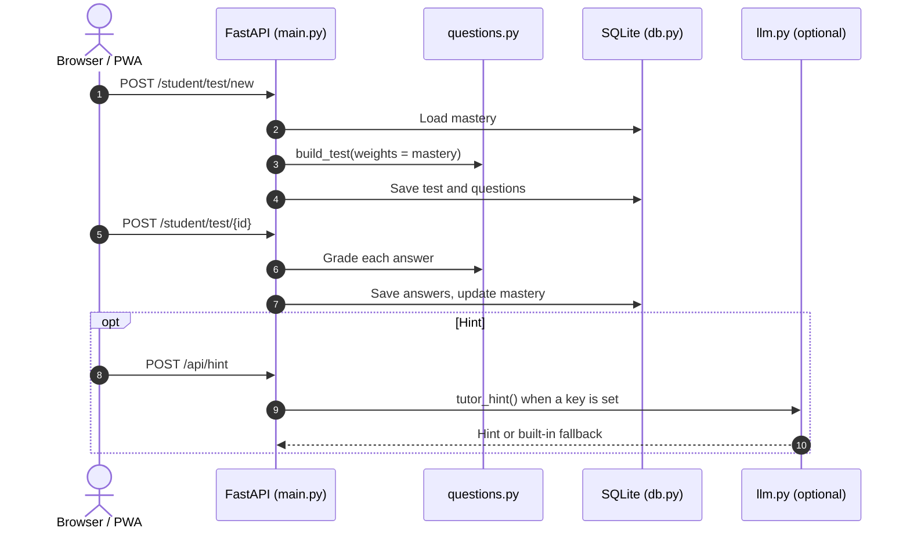

# ⚙️ Technical flow

How School Hack is built and where data goes. These diagrams match the **Technical** lens of the in-app Archify view. Open [`website/index.html#archify/tech`](../website/index.html) and press **Play**, or **Simulate an answer** to see a real generated question go through the real grader.

## Two versions, one design

| | `website/` | `backend-python/` |
|---|---|---|
| Runs as | One `index.html`, no build step | FastAPI + Uvicorn on port 8000 |
| Storage | Browser `localStorage`, per device | SQLite in `backend-python/data/` |
| Accounts | Demo login `admin / admin` | Demo login `admin / admin`, student and teacher portals |
| Test | Every skill twice, shuffled | Every skill twice, weighted toward weak skills |
| AI (optional) | Claude when the page runs on claude.ai | Claude when `ANTHROPIC_API_KEY` is set |
| Without AI | Built-in hints and summary | Built-in hints and summary |

## Runtime architecture

<b>📝 Taking a test</b>: build → show → grade → feedback → save

 

<b>💡 Getting a hint</b>: Claude when available, built-in hints otherwise

 

No name or score is ever sent with a hint.

<b>🤖 Teacher gap finder</b>: five explainable steps

 

In the Python version the same flow runs on the server: `GET /api/teacher/overview` then `POST /api/agent`.

<b>🐍 Python version</b>: request routes

 

## Where data lives

| Data | Website | Python version | Sent to Claude? |
|---|---|---|---|
| Stars, streak, mastery, tests | `localStorage` (`sh_state_v1`) | SQLite | ❌ |
| Language choice | `localStorage` (`sh_lang`) | n/a | ❌ |
| Student names | Demo names in code | SQLite | ❌ never |
| Question, answer, method (for a hint) | in memory | in memory | ✅ only if Claude is available |
| Skill names + class percentages (summary) | in memory | in memory | ✅ only if Claude is available |

## Components

| File | Responsibility |
|---|---|
| `website/index.html` | The whole standalone app: UI, `SKILLS`, templates `T`, `grade`, gap finder `analyse`, and the Archify view (`ARCH`). |
| `backend-python/app/main.py` | FastAPI app, page and API routes, role checks, startup database setup. |
| `backend-python/app/questions.py` | Skill graph, adaptive test assembly, grading and feedback. |
| `backend-python/app/db.py` | SQLite schema, demo seeding, persistence, mastery updates, class analytics. |
| `backend-python/app/agent.py` | Explainable teacher gap finder and suggested actions. |
| `backend-python/app/llm.py` | Optional Claude integration with local fallback. |
| `backend-python/app/templates/`, `static/` | Server-rendered pages, styles, charts, icons and PWA files. |
